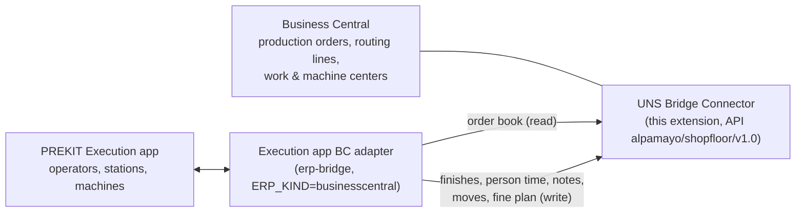

# UNS Bridge Connector

[](https://github.com/alpamayo-solutions/Dynamics365-BC-UNS/actions/workflows/build.yml)

A Microsoft Dynamics 365 Business Central extension that lets the **PREKIT shop floor Execution app**
run on Business Central production orders, the same way it runs on ERPNext.



## What it does

| Direction | What | Where in BC |
|---|---|---|
| Read | Released and recently finished production orders, routing lines as **steps** (sequence, place, planned minutes, routing status), work and machine centers, items | API pages |
| Write | **Step finish**: output, scrap, setup and run time, where it ran, who finished it | Routing line fields; optionally an output journal posting |
| Write | **Person time** per step (one row per time slice; revisions supersede, cancels cancel) | Execution Person Time |
| Write | **Operator notes** on a production order | Notes FactBox of the order |
| Write | **Step moves** (reroute a not-started step to another work or machine center) | Routing line Type / No. |
| Write | **Fine plan** per station (planned start/end, queue position) | Routing line fields, no rescheduling |
| BC side | **Hold** / **Release Hold** on a released production order | Released Production Order actions |

The full API contract, including the step id format and error semantics, is in
[docs/execution-app-contract.md](docs/execution-app-contract.md).

## Posting: off by default

**Shopfloor Execution Setup → Post Output** decides what a finished step does:

| Post Output | Effect |
|---|---|
| Off (default) | The step is recorded on the routing line (Execution Finished, output, scrap). Nothing is posted; inventory, capacity and costing are untouched. |
| On | The step also posts one output journal line, exactly as the standard Production Journal would: output and scrap quantity, setup and run time, Finished = yes. The routing status becomes Finished; on the last operation the output is booked to inventory and backward-flushed components are consumed. |

In both modes Business Central enforces the sequence (a step cannot finish before its previous operations)
and refuses finishes on held orders.

## Install and upgrade

- Business Central 26 (2025 release wave 1) or later, Cloud or on-premises.
- Upload `alpamayo_UNS Bridge Connector_<version>.app` in **Extension Management**.
- Upgrading from 1.x works in place. The 1.x execution tables are obsolete in 2.0 and their data is
  deleted during the upgrade; nothing from 1.x is carried over.
- Permission sets:
  - **ALP Shopfloor Exec** for the Execution app's integration user (Entra app). With Post Output on,
    the user also needs the standard rights to post output journals (for example *D365 MFG, EDIT*).
  - **ALP Shopfloor View** for read-only users, **ALP Shopfloor Admin** for whoever maintains the setup.

## Repository layout

| Path | Content |
|---|---|
| `app/` | The extension (AL project, `app/app.json` holds the version) |
| `test/` | The test app (AL test codeunits, run in a BC container in CI) |
| `docs/` | API contract and plans |
| `dev/bridge` | Dev CLI and Streamlit GUI to call the API against a sandbox or container |

## Development

### Compile locally (macOS / Linux)

The AL compiler from the VS Code AL extension runs on .NET 10:

```bash
dotnet ~/.vscode/extensions/ms-dynamics-smb.al-<version>/bin/alc.dll \
  /project:app /packagecachepath:app/.alpackages /out:build/app.app \
  /analyzer:<same bin>/Microsoft.Dynamics.Nav.CodeCop.dll \
  /analyzer:<same bin>/Microsoft.Dynamics.Nav.UICop.dll \
  /analyzer:<same bin>/Microsoft.Dynamics.Nav.PerTenantExtensionCop.dll
```

Symbols for `app/.alpackages` come from *AL: Download symbols* in VS Code. The test app additionally needs
the test library symbols (Library Assert, Tests-TestLibraries and their dependencies) in `test/.alpackages`.

### Run tests

Tests need a Business Central service tier, which runs only on Windows. CI (`.github/workflows/build.yml`)
creates a BC 26 container with BcContainerHelper, installs the last 1.x release, upgrades it to the build,
then publishes and runs the test app. To do the same on a Windows machine, run the steps of that workflow
in PowerShell.

### Release

See [RELEASING.md](RELEASING.md).
